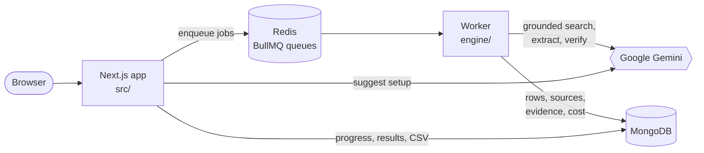

# Rowsmith

Upload a CSV, describe the columns you need, and Rowsmith researches every row on the web. Each filled cell comes with its source and a supporting quote. Cells that no source states stay blank, with a reason. Every row shows what it cost.

## What you get

Input: a list with a column to fill.

```csv
name,country,founded
Notion,USA,
Canva,Australia,2012
Zerodha,India,
```

Output (a real run, trimmed):

| name | country | founded | _sources | _evidence | _status | _cost_usd | _comments |
|---|---|---|---|---|---|---|---|
| Notion | USA | 2013 | [1] notion.so/blog/… ; [2] en.wikipedia.org/wiki/Notion_… | founded: "Notion (developed by Notion Labs, Inc.) was founded in 2013" [1, 2] (search summary) | done | 0.017999 | founded comes from the search's summary of the sources, not from text we could read on the page, so check it before relying on it. |
| Canva | Australia | 2012 | [1] canva.com/about/ ; … | | done | 0.017730 | |
| Zerodha | India | 2010 | [1] zerodha.com/about/ ; [2] en.wikipedia.org/wiki/Zerodha ; … | founded: "Founded: August 2010; 16 years ago ( August 2010 )" [2] | done | 0.019748 | |

The exported CSV has:

| Columns | What they hold |
|---|---|
| Your original columns | Kept in place. Blank cells in a column you chose to fill are filled; your own values are never overwritten (Canva's `2012` above). |
| New fields | Any fields you added that aren't in the file, after your columns. |
| `_sources` | Numbered source URLs for the row: `[1] url; [2] url`. |
| `_evidence` | One line per researched field: the supporting quote and its source numbers, or why it is blank: `Not found in sources`, `Removed: no source quote states it` or `Removed: the source quote doesn't support it`. Quotes from the search model's summary rather than a page we read are marked `(search summary)`. |
| `_status` | `done`, or `failed: <reason>` if the row couldn't be researched. |
| `_cost_usd` | What the row cost in Gemini tokens and search queries. |
| `_comments` | A plain-language note on why cells are blank and which values to double-check. Empty when there is nothing to say. |

## Quick start

You need [Docker](https://docs.docker.com/get-docker/) and a Gemini API key from [Google AI Studio](https://aistudio.google.com/apikey).

```bash
git clone https://github.com/aniketbetkikar/rowsmith.git
cd rowsmith
cp .env.example .env    # then set GEMINI_API_KEY
docker compose up
```

Open http://localhost:3000. Compose builds the image and starts the app, the worker, MongoDB and Redis. To use another port, run `PORT=3100 docker compose up`.

> Grounded search is billed per query, about $0.02–0.04 per row with the default models. Check your Gemini quota and billing first.

## How it works

1. **Upload** a CSV (up to 500 rows / 1 MB).
2. **Set up**: Rowsmith reads the file and suggests the key column (what each row is), a description, the fields to fill and where each fact is usually published. If the file has mostly-empty columns, those become the fields; otherwise it proposes new ones. You can edit everything, add fields, and add or remove the sites to search.
3. **Estimate**: a 5-row preview runs first and estimates the full run's cost.
4. **Run**: the full job shows live progress, a results table with quotes in tooltips, and the running cost. Failed rows can be retried. Rows already done in the preview aren't researched again.
5. **Download** the CSV.

### Why it's more reliable than asking an LLM directly

A cell is filled **only if a cited source states it**.

| Problem with plain LLMs | What Rowsmith does |
|---|---|
| Invents facts | Runs a **grounded Google search** and keeps only notes that carry a citation |
| No sources | Stores **sources and supporting quotes** for every cell |
| Broken formatting | Builds a **strict JSON schema** from your fields (text, number, year, url, enum, list, boolean) |
| Plausible but unsupported values | A **quote check** (no LLM) and a separate **verify** pass reject any value its quotes don't back |
| Relies on snippets | **Reads the pages** itself (the entity's own site, Wikipedia, registries, one PDF) to quote real page text |
| Duplicates cost twice | **Dedupes** keys so each entity is researched once |
| Unknown cost | Tracks **token and search cost per row** and per job |

Each row goes through:

```
research (grounded search, ≤2 per row) → read pages → extract { value, quotes } → quote check → verify
```

## Architecture



| Part | What it does |
|---|---|
| **Next.js app** (`src/`) | Next.js 16 App Router, Tailwind, shadcn/ui. A thin layer: the wizard, Zod-validated API routes, job creation, progress polling and CSV export. Its only LLM call is `/api/suggest`. |
| **Worker** (`engine/`) | A plain Node process that does all the research: `contracts` (shared Zod schemas), `core` (pure pipeline logic), `llm` (Gemini clients and model catalog), `db`, `queue`, `processors` and `eval`. |
| **Redis** | BullMQ queues (a `prepare` job per run, an `enrich` job per row) and per-IP rate limits. |
| **MongoDB** | Jobs and rows: values, sources, quotes, blank reasons and cost. |
| **Google Gemini** | Grounded search (`@google/genai` with the `googleSearch` tool), and structured extraction and verification (LangChain). |

[CLAUDE.md](CLAUDE.md) documents the code layout, conventions and every step of the pipeline.

## Local development

Prerequisites: Node.js 22+, pnpm 9 (`corepack enable`), and MongoDB and Redis on localhost:

```bash
docker run -d --name rowsmith-mongo -p 27017:27017 mongo:8
docker run -d --name rowsmith-redis -p 6379:6379 redis:7
```

The defaults in `.env.example` point at these. Run the app and the worker in two terminals:

```bash
pnpm install
pnpm dev          # Next.js app on http://localhost:3000
pnpm worker:dev   # background worker
```

### Environment variables

The app and the worker share one `.env`. [.env.example](.env.example) lists every variable with its default.

| Variable | Used by | Purpose |
|---|---|---|
| `MONGODB_URI` | app + worker | MongoDB connection string (Docker Compose sets its own) |
| `REDIS_URL` | app + worker | Redis for queues and rate limits (Docker Compose sets its own) |
| `GEMINI_API_KEY` | app + worker | Google Gemini API key |
| `APP_URL` | app | Public base URL, for absolute links in page metadata |
| `DEFAULT_MINUTES_PER_FIELD` | app | Minutes per value done by hand, for the "time saved" figure (default `0.5`) |
| `MODEL_SEARCH` / `MODEL_EXTRACT` / `MODEL_VERIFY` | worker | Model for each pipeline role |
| `MODEL_SUGGEST` | app | Model that proposes the job setup |
| `MODEL_JUDGE` | evals | Grader model for the evals |
| `MODEL_<ROLE>_FALLBACKS` | app + worker | Comma-separated models tried in order when a role's model answers 503 |
| `ENRICH_CONCURRENCY` | worker | Rows processed in parallel (default `5`) |
| `RATE_MAX` | worker | Max row jobs per second (default `5`) |
| `LOG_LEVEL` | worker | pino log level (default `info`) |

Every model must be listed in `MODEL_CATALOG` ([engine/llm/models.ts](engine/llm/models.ts)), which holds its price and supported thinking levels. To use another model, add it there with its price from Google's pricing page.

### Scripts

| Command | What it does |
|---|---|
| `pnpm dev` / `pnpm build` / `pnpm start` | Next.js app |
| `pnpm worker:dev` / `pnpm worker:start` | Worker (watch mode / production) |
| `pnpm typecheck` | `next typegen` + `tsc --noEmit` |
| `pnpm lint` | ESLint, which also enforces the import boundaries |
| `pnpm test` | Vitest unit tests (no network, no API key) |
| `pnpm eval [--set deals,towns] [--baseline]` | Accuracy and cost report on the hand-verified gold sets ⚠️ |
| `pnpm eval:lists` | Grades open-ended list fields with a grounded fact-check ⚠️ |

⚠️ These call the real Gemini APIs and **cost money**.

## Cost

A row costs about **$0.02–0.04** with the default models; most of it is the grounded search queries. Prices, including announced changes, live in `MODEL_CATALOG`, so cost is computed from actual token and query counts. Prices change, so check them against Google's pricing page.

## Limits and abuse protection

The defaults suit a public demo running on your own API key:

- Uploads up to **500 rows / 1 MB**. A preview runs **5 rows** and a full job **25 rows** (`ROW_CAPS` in [engine/contracts/job-status.ts](engine/contracts/job-status.ts)). Raise `full` for your own use.
- Per-IP rate limits backed by Redis: 10 suggests/min, 5 job creations/min, 5 retries/min and 120 reads/min ([src/lib/rate-limit.ts](src/lib/rate-limit.ts)).
- A full run can take an email address. It is optional and only stored with the job.

There are no accounts, auth or billing. If you deploy it publicly, keep these caps or put the app behind auth.

## Known limitations

- A quote proves a value traces back to a grounded source. It doesn't prove the page still says it today, so stale sources can pass.
- Strict checks favour blanks over guesses, so some correct values are dropped.
- Progress is shown by polling, not streaming.

## Contributing

Issues and pull requests are welcome. See [CONTRIBUTING.md](CONTRIBUTING.md). To report a vulnerability, see [SECURITY.md](SECURITY.md).

## License

Copyright (C) 2026 Aniket Betkikar.

Rowsmith is licensed under the [GNU Affero General Public License v3.0](LICENSE). You can use, modify and self-host it. If you run a modified version as a network service, the AGPL requires you to offer its source code to that service's users under the same license.
